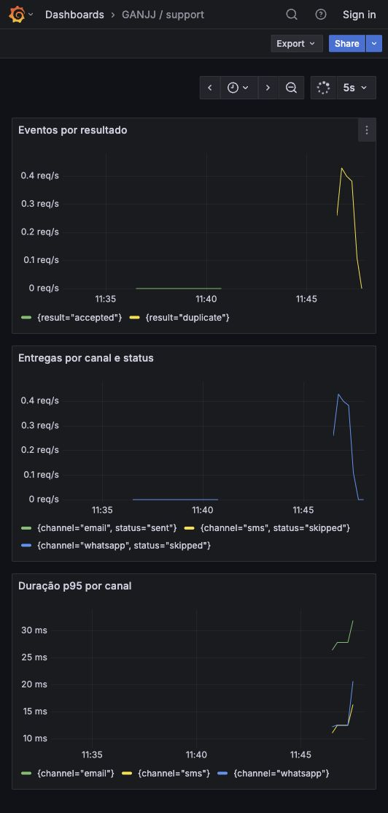

# Roteiro N2 — Serviço de Suporte (10/11/2026)

Rubrica: R1 arquitetura distribuída em Kubernetes (4,0) · R2 segurança, distribuição e observabilidade (3,0) ·
R3 apresentação técnica (3,0). Este roteiro cobre a parte do suporte; a ordem final depende do grupo.

## Demonstração

| # | O quê | Como mostrar | Rubrica |
|---|---|---|---|
| 1 | Serviço e Mailpit no cluster | `kubectl get pods` (suporte e mailpit `1/1`) | R1 |
| 2 | Pedido dispara aviso | criar pedido no `order` (ou `curl` do contrato) e abrir a UI do Mailpit | R1 |
| 3 | Segredo interno | mesma chamada sem `x-internal-secret`: 403 | R2 |
| 4 | Idempotência | repetir o mesmo `event_id`: `duplicate:true` e nenhum e-mail novo | R1 |
| 5 | Canais simulados | `GET /internal/notifications/{id}` mostra sms e whatsapp `sent` com provider `fake` | R1 |
| 6 | Persistência | `kubectl delete pod` e o histórico continua (volume) | R1 |
| 7 | Distribuição | `helm install` do chart já validado no laboratório | R2 |
| 8 | Observabilidade | painel Grafana: eventos por resultado e envios por canal e status | R2 |

## Decisões para defender (R3)

- Serviço de suporte separado: o `order` não conhece SMTP nem provedores ([ADR 0004](adr/0004-canais-por-adapter.md)).
- Outbox do order publica OrderCreated em RabbitMQ; HTTP interno permanece como fallback ([ADR 0002](adr/0002-http-antes-de-rabbitmq.md)).
- Destinatário no payload, sem acoplamento com `client` ([ADR 0005](adr/0005-destinatario-no-payload.md)).
- SQLite para idempotência e histórico; limite de 1 réplica assumido ([ADR 0003](adr/0003-sqlite.md)).
- 202 imediato e envio assíncrono: pedido não espera SMTP; falha de envio não derruba o pedido.
- Canais por variável de ambiente: troca para SMS e WhatsApp reais sem alterar código.

## Perguntas prováveis

- Por que SMS e WhatsApp são simulados? A conta trial está criada e a resposta automática WhatsApp foi entregue. Os envios pela aplicação ainda não foram comprovados; os adapters reais e o modo trial estão implementados ([canais-reais.md](canais-reais.md)).
- E se o suporte cair? O `order` continua criando pedidos e registra o evento no outbox na mesma transação. O publisher tenta novamente; RabbitMQ mantém a entrega pendente e o support trata duplicatas por event_id. O fallback HTTP isolado permanece best effort.
- Dá para ter duas réplicas? Não com SQLite; Postgres é o caminho.
- Como garante que não manda e-mail duplicado? `event_id` como chave primária.
- Por que Java? Spring Boot alinha a stack ao authorization; Spring Mail e Micrometer atendem SMTP e observabilidade, com SQLite persistente para a única réplica.

## Antes do dia

- [x] Imagem `eduardofabri/support:1.0.3` pública e multi-arch (amd64 e arm64), validada no laboratório em 29/10.
- [ ] Mailpit exposto por `port-forward` para mostrar a caixa.
- [x] `order` real publicando OrderCreated e gerando aviso, comprovado em 28/10 (Cart/Product eram fixtures).
- [x] Painel Grafana exportado em JSON e importado no laboratório; conferir disponibilidade antes do ensaio.
- [ ] Ensaio cronometrado.

## Evidência executada em 25/10/2026

A demonstração técnica foi exercitada: gateway → order real com SQL Server → support → e-mail no Mailpit, repetição idempotente e histórico após recriar o pod. Cart e Product eram fixtures explícitas. As imagens estão públicas no Docker Hub, com AMD64/ARM64. O consumidor RabbitMQ foi testado com broker real; Twilio foi testado contra HTTP simulado, sem envios externos.

O ensaio humano do grupo continua pendente. Sugestão de 3 minutos: 30s de arquitetura, 60s para criar pedido e mostrar Mailpit, 30s para idempotência/PVC, 45s para Grafana e 15s para explicar os canais fake/Twilio preparado. Anotar os tempos medidos no ensaio, sem substituir por estes tempos planejados.

## Atualização para o ensaio

A evidência de 28/10 inclui publisher real no order, outbox, SQL Server e RabbitMQ, com o fallback HTTP indisponível. O support recebeu o evento e gerou exatamente um e-mail no Mailpit. As observações anteriores sobre ausência de publisher correspondem ao estado de 25/10.

Em 29/10 a validação de desenvolvimento e o laboratório Twilio seguem locais por decisão de Eduardo; a apresentação compartilhada segue o kit EKS do grupo. Não apresentar o DNS Kubernetes como URL pública, a resposta automática Twilio como envio da aplicação, ou a resposta automática WhatsApp como envio iniciado pelo support. A versão 1.0.3 foi publicada e instalada no laboratório isolado em 29/10. Os tempos do ensaio devem ser medidos pelo grupo; este roteiro e as demonstrações técnicas não concluem a issue de ensaio.
